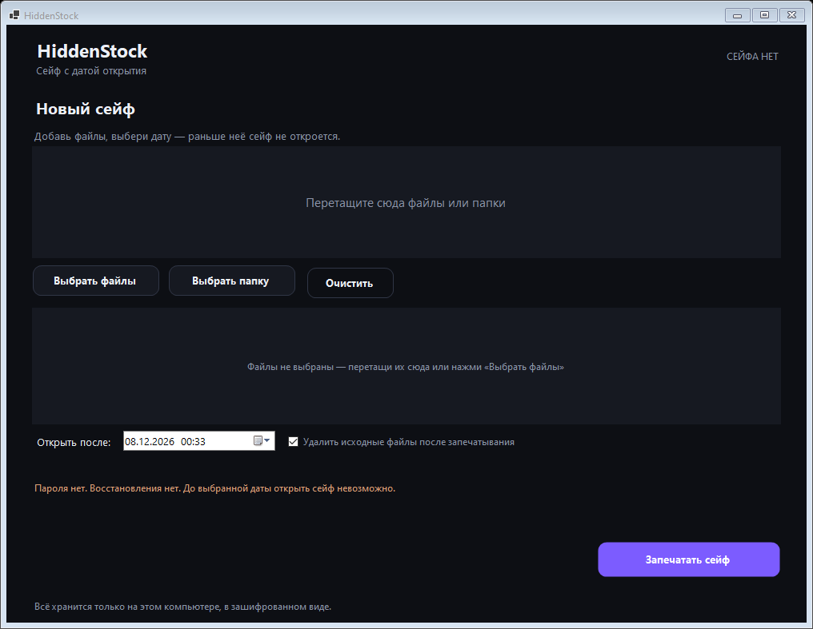
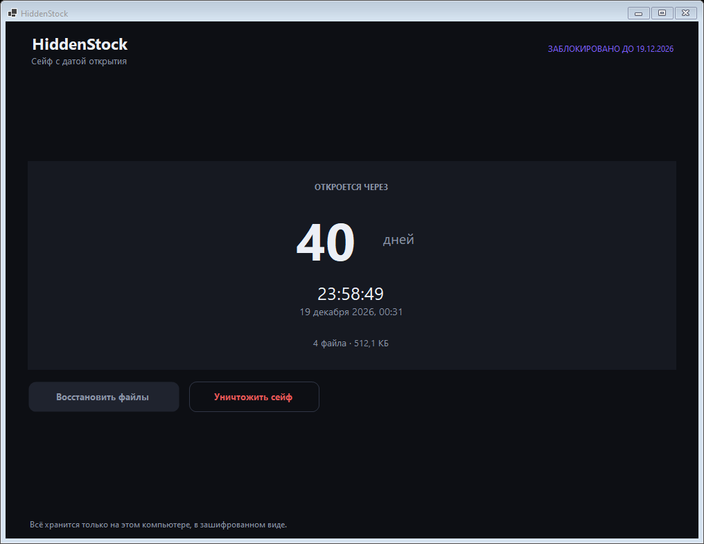
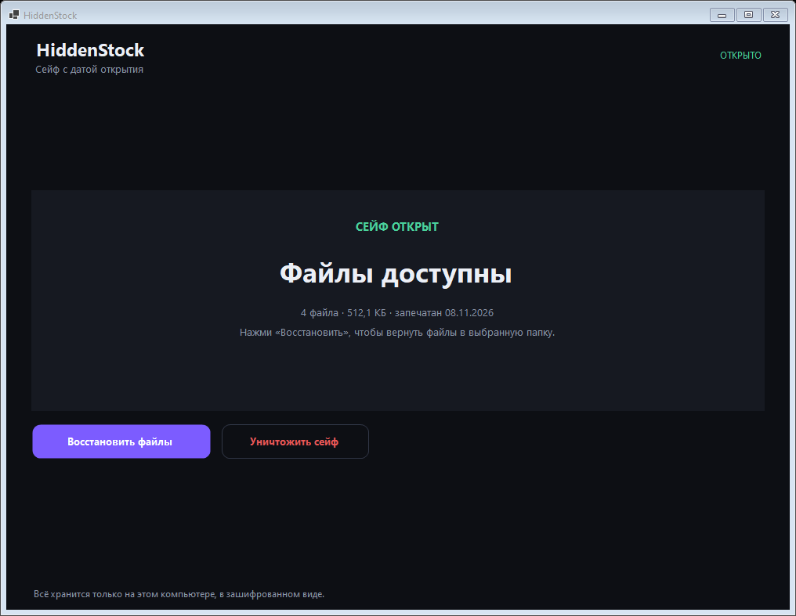

# HiddenStock

Сейф с датой открытия для Windows. Кладёшь в него файлы, указываешь дату — до этой даты программа их не показывает и не отдаёт. После даты файлы снова доступны.

## Что умеет

- перетаскивание файлов и папок в окно или выбор через диалог;
- шифрование AES-256-GCM, отдельный ключ на каждый файл;
- ключ сейфа хранится в Windows DPAPI — привязан к учётной записи и этому компьютеру;
- дата открытия с обратным отсчётом, иконка в трее;
- две скрытые копии сейфа и самовосстановление, если основную удалили;
- защита от перевода часов назад;
- восстановление файлов в выбранную папку с проверкой контрольных сумм;
- удаление исходников после запечатывания (по желанию).

## Как пользоваться

1. Запустить `HiddenStock.exe`.
2. Перетащить файлы и папки в окно (или «Выбрать файлы» / «Выбрать папку»).
3. Указать дату, раньше которой сейф не должен открываться.
4. Нажать «Запечатать сейф» и подтвердить.
5. В день открытия нажать «Восстановить файлы» и выбрать папку.

Программа сворачивается в трей и продолжает считать дни.

## Скриншоты







## Где лежат данные

| Что | Где |
|---|---|
| Сейф | `%LOCALAPPDATA%\HSX\data\vault.hsx` |
| Копия 1 | `%APPDATA%\HSX\mirror\vault.hsx` |
| Копия 2 | `%PROGRAMDATA%\HSX\mirror\vault.hsx` |
| Якорь времени | `%LOCALAPPDATA%\HSX\state\anchor.dat` + реестр `HKCU\Software\HSX` |

Папки помечены атрибутами Hidden + System, файлы внутри не имеют расширений и не открываются двойным кликом.

## Честно о защите

- **От случайного просмотра** — да: шифр, скрытые папки, нет превью, нет имён файлов снаружи.
- **От целенаправленного обхода** — нет. Ключ хранится на этом же компьютере, замок — только код программы. Кто полезет с отладчиком или своим скриптом, откроет раньше срока.
- **Пароля нет и восстановления нет.** Переустановка Windows, смерть диска или профиля — файлы не вернуть. Копии на другом физическом носителе — единственная страховка; делайте их, если данные важны.
- **Удаление сейфа необратимо** — требуется ввести слово УДАЛИТЬ.

## Если не запускается

Программа пишет лог каждого запуска:

```
%LOCALAPPDATA%\HSX\logs\app.log
```

- **Файла нет** — процесс вообще не стартовал. Скорее всего файл заблокирован Windows: правый клик по exe → Свойства → «Разблокировать», либо антивирус удалил/заблокировал его (файл без цифровой подписи).
- **В логе `EnableVisualStyles не применён`** — не страшно: Windows не дала создать временный файл, программа запускается без системных тем оформления, окно всё равно открывается.
- **В логе `СБОЙ`** — там же будет текст ошибки.

## Сборка

```powershell
dotnet publish -c Release -r win-x64 --self-contained true `
  -p:PublishSingleFile=true -p:IncludeNativeLibrariesForSelfExtract=true `
  -p:EnableCompressionInSingleFile=true -p:DebugType=none -o publish
```

Результат — один файл `publish\HiddenStock.exe`, ~49 МБ, без установки и без .NET на целевой машине.

## Тесты

```powershell
HiddenStock.exe --selftest
```

Прогоняет 20 проверок: запечатывание, отказ до даты, восстановление с побайтовым сравнением, защита заголовка от подмены, удаление исходников, сторож времени. Результат пишется в `%TEMP%\hsx_selftest.log` (или в путь из `HSX_LOG`).

## Структура

```
Core/
  AppPaths.cs   пути и реплики
  Crypto.cs     AES-GCM, вывод ключей
  Dpapi.cs      обёртка Windows DPAPI
  TimeGuard.cs  сторож времени и защита от отката
  Vault.cs      формат контейнера, запечатывание, восстановление
  SelfTest.cs   сквозной тест
  Demo.cs       демо-данные для скриншотов
UI/
  Theme.cs      палитра и шрифты
  Controls.cs   кнопки, карточки, зона перетаскивания
  MainForm.cs   окно, три состояния, трей
```

## Что ещё не сделано

- служба-сторож с автовосстановлением в реальном времени (сейчас восстановление при запуске);
- ACL deny-delete на сейф;
- очистка превью Windows и списка недавних файлов;
- установщик и автозапуск;
- уведомление в день открытия, если программа была закрыта.
